  

  

  
  
  

## 👨‍💻 About Me

- 🔭 Working on **Adaptive Variable Resolution 2.5D Lidar Mapping for Dynamic Environment Perception**
- 🌱 Learning **ROS 2** and the **A\* algorithm**
- 👯 Looking to collaborate on **2.5D Lidar Mapping**
- 📫 Reach me at **[deatdev.2008@gmail.com](mailto:deatdev.2008@gmail.com)**
- ⚡ **Fun fact:** *Just like composing music, building a JavaScript framework requires finding the perfect harmony between structure and creativity!*

  

## 🛠️ Languages & Tools

  

## 📊 GitHub Stats

  

  

## 🤝 Connect With Me

  
  
  

<i>Thanks for stopping by! ⭐</i>

